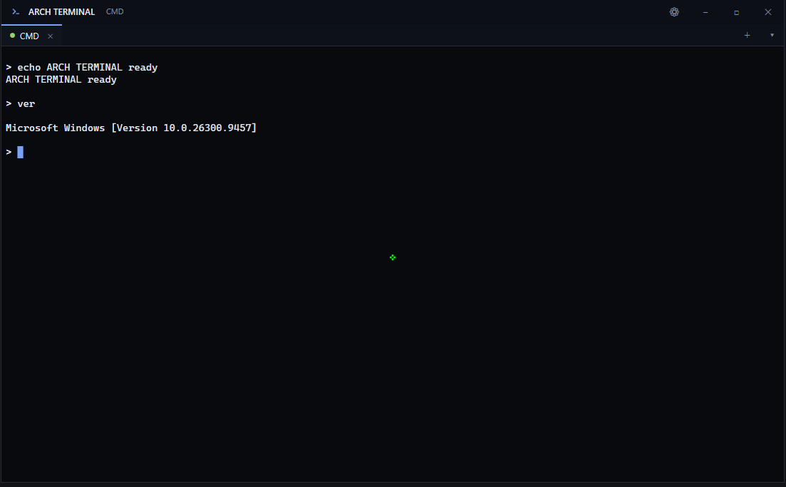
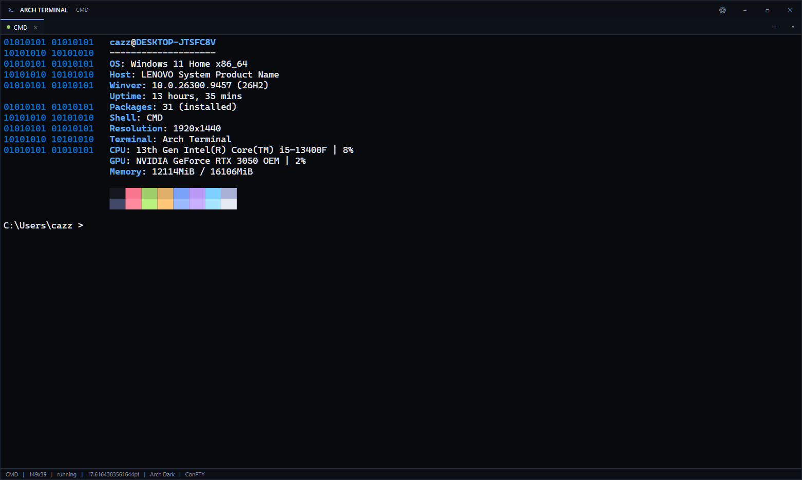

<div align="center">

# Nixue CMD

**A minimalist, Hyprland-inspired terminal for Windows.**

Real Windows shells (CMD, PowerShell, PowerShell 7) through the Windows pseudoconsole
(ConPTY), with multiple tabs, a built-in `winfetch`, live CPU/GPU stats, custom fonts,
and a clean dark theme with sharp corners.




</div>

---

## Highlights

- **Real shells via ConPTY** — CMD (default), Windows PowerShell, and PowerShell 7
  (when installed). Each tab is its own process with its own working directory,
  environment and scrollback. The requested shell is never silently swapped.
- **`winfetch` built in** — a neofetch-style summary that clears the screen, draws the
  Windows logo in **binary (1s and 0s)**, and shows Windows-native facts with **live
  CPU and GPU usage** (e.g. `GPU: NVIDIA GeForce RTX 3050 | 88%`). Runs in ~0.7s.
- **Directory in the prompt** — after `cd`, the current path appears before the `>`
  (`C:\Users\you > `). Toggleable.
- **Custom fonts** — drop `.ttf`/`.otf` into `Documents\Nixue\fonts` and pick one from
  the dropdown in Settings.
- **Right-click "Open with" integration** — an opt-in entry (per-user, no admin) for
  files and folders. Opening a file starts a terminal in its folder and offers to paste
  the file's contents.
- **Polished terminal engine** — VT100/VT220/xterm-subset parser (SGR 16 / 256 / true
  colour, cursor moves, scroll regions, alternate screen, bracketed paste, OSC titles),
  correct handling of split escape sequences and UTF-8 boundaries.
- **Nice to use** — smooth fading cursor with a misty typing trail, four themes, font
  resizing, mouse selection & clipboard, bounded scrollback, and a modern settings panel.

<div align="center">



</div>

## Requirements

| | |
| --- | --- |
| **OS** | Windows 10 version 1809 (build 17763) or newer, or Windows 11 |
| **Runtime** | .NET Framework 4.x (ships in-box on Windows 10/11 — nothing to install) |

ConPTY requires build 17763+. On older builds Nixue shows a clear message and exits.
No .NET SDK, Visual Studio, MSBuild, NuGet, or internet connection is needed to build
or run it.

## Setup

### Option 1 — Download the portable release (recommended)

1. Grab `Nixue-<version>-portable.zip` from the **Releases** page (or build it, below).
2. Extract it anywhere.
3. Run **`Nixue.exe`**. That's it — no installation, no admin rights.

The folder is self-contained (`Nixue.exe`, `Nixue.Core.dll`, `winfetch.exe`); it can be
copied or moved anywhere.

### Option 2 — Build from source

No SDK required — Nixue builds with the in-box .NET Framework C# compiler.

```bash
git clone https://github.com/<you>/nixue-cmd.git
cd nixue-cmd
```

Then, in **PowerShell** from the repo root, either run the clean rebuild batch:

```bat
build\build.bat
```

…or call the build script directly:

```powershell
powershell -ExecutionPolicy Bypass -File scripts\build.ps1 -Configuration Release
```

Both produce `build\Nixue.exe`, `build\Nixue.Core.dll` and `build\winfetch.exe`. Launch:

```bat
build\Nixue.exe
```

To make a portable zip under `dist\`:

```powershell
powershell -ExecutionPolicy Bypass -File scripts\publish.ps1
```

To run the test suites (unit + real-shell integration):

```powershell
powershell -ExecutionPolicy Bypass -File scripts\test.ps1
```

> **Note:** the bundled compiler is **C# 5**, so the source is written to that language
> level. See [`BUILD.md`](BUILD.md) for details and troubleshooting.

### Enable the right-click "Open with" entry (optional)

Open **Settings** (gear icon or `Ctrl+,`) and click the **Add 'Open with…'** button.
This writes a per-user registry entry (under `HKCU`, no admin) and is fully reversible
from the same panel.

## Usage

Type `winfetch` in any tab for the system summary. Everything else is a normal Windows
shell — run any command your shell and account allow.

### Keyboard shortcuts

| Shortcut | Action |
| --- | --- |
| `Ctrl+Shift+T` | New tab |
| `Ctrl+W` | Close active tab |
| `Ctrl+Tab` / `Ctrl+Shift+Tab` | Next / previous tab |
| `Ctrl+Shift+C` / `Ctrl+Shift+V` | Copy selection / paste |
| `Ctrl++` / `Ctrl+-` / `Ctrl+0` | Font size up / down / reset |
| `Ctrl+L` | Clear screen |
| `Ctrl+Shift+P` | Shell selection menu |
| `Ctrl+Shift+N` | New window |
| `Ctrl+,` | Settings |
| `F11` / `Esc` | Toggle / leave fullscreen |
| `Shift+PageUp/PageDown/Home/End` | Scrollback navigation |

`Ctrl+C` sends the interrupt to the shell; use `Ctrl+Shift+C` to copy.

## Configuration

Settings, logs and fonts live under your Documents folder — no admin rights, no
machine-wide changes:

- `Documents\Nixue\settings.json`
- `Documents\Nixue\logs\` (only when diagnostic logging is enabled)
- `Documents\Nixue\fonts\` (drop `.ttf`/`.otf` here, then pick one in Settings)

## Project layout

```
src/Nixue.Core/      WPF-free core: VT parser, buffer, config, themes, shell discovery
src/Nixue.App/       WPF app (pure C#, no XAML): ConPTY backend, sessions, UI
src/Nixue.WinFetch/  the winfetch command
tests/               unit + integration test runners
scripts/             build.ps1 / test.ps1 / publish.ps1
docs/                ARCHITECTURE, COMPATIBILITY, TESTING
```

More detail in [`docs/ARCHITECTURE.md`](docs/ARCHITECTURE.md),
[`docs/COMPATIBILITY.md`](docs/COMPATIBILITY.md) and [`docs/TESTING.md`](docs/TESTING.md).

## Security & privacy

Nixue runs commands with your own user permissions — it is not a sandbox. It does not
elevate privileges, collect credentials, modify global shell profiles or system
environment variables, or send anything over the network. Diagnostic logging never
records command contents, clipboard data or environment secrets.

## Known limitations

- No reflow of wrapped lines on resize.
- Mouse-reporting escape sequences are parsed but not forwarded to the shell.
- Bold/italic depend on the chosen font providing those faces.
- Windows 10 1809 (build 17763) or newer is required (ConPTY).

## License

[MIT](LICENSE) © Nixue CMD Project.

Nixue CMD is an independent project, inspired by the visual style of Hyprland and
minimalist Linux terminal setups. It is not affiliated with or endorsed by any of them.

Please also note that the code is subject to change so features may be available one day and another they are not.
